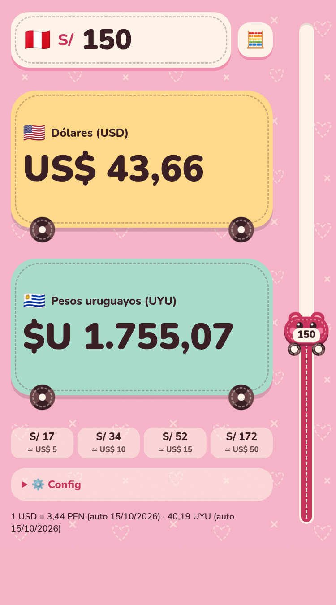

# Sol → USD / UYU

Calculadora para convertir **soles peruanos (PEN)** a **dólares (USD)** y **pesos uruguayos (UYU)**, pensada para usar desde el celular.

**👉 [Abrir la calculadora](https://atarantini.github.io/sol-dolar-pesos/)**

<p align="center">
  
</p>

## Cómo se usa

1. **Ingresá un monto en soles.** Arrastrá el auto del slider vertical (0 abajo, 1000 arriba) o escribilo en el campo de arriba.
2. **Mirá el resultado.** Las dos tarjetas muestran al instante el equivalente en dólares y en pesos uruguayos.
3. **Atajos.** Los botones de abajo ponen el monto en soles que equivale a US$ 5, 10, 15 o 50 con la cotización actual.
4. **Teclado numérico.** El botón 🧮 cambia entre el slider y un teclado numérico. La app recuerda el modo elegido.
5. **Cotización manual.** En ⚙️ Config podés fijar tus propias tasas (PEN y UYU por 1 USD). "Volver a cotización automática" las borra.

## Cotizaciones

Se obtienen de [open.er-api.com](https://www.exchangerate-api.com/docs/free) cada vez que se abre la app, y la fecha de la última actualización aparece al pie. Son tasas de referencia, no las de una casa de cambio.

Si no hay conexión se usa la **última cotización guardada** en el dispositivo. Si nunca se descargó ninguna, se usan valores aproximados (1 USD ≈ 3,5 PEN ≈ 40 UYU).

## Funciona sin conexión

Es una PWA: después de abrirla una vez con internet, un service worker guarda la app y funciona sin conexión. Se puede instalar desde el navegador ("Instalar app" o "Agregar a pantalla de inicio"). El monto y los ajustes se guardan en el navegador.

## Desarrollo

No tiene dependencias ni paso de build: es un único `index.html` más `sw.js`, `manifest.webmanifest` e `icons/`.

```bash
./web.sh        # http://localhost:8899 (necesita PHP)
```

`web.sh` usa `router.php` para enviar los headers de caché. Al publicar un cambio en `sw.js` o en los archivos cacheados, subí el número de `VERSION` en `sw.js` para que los dispositivos se actualicen.

Se publica con GitHub Pages desde la rama `main`.
